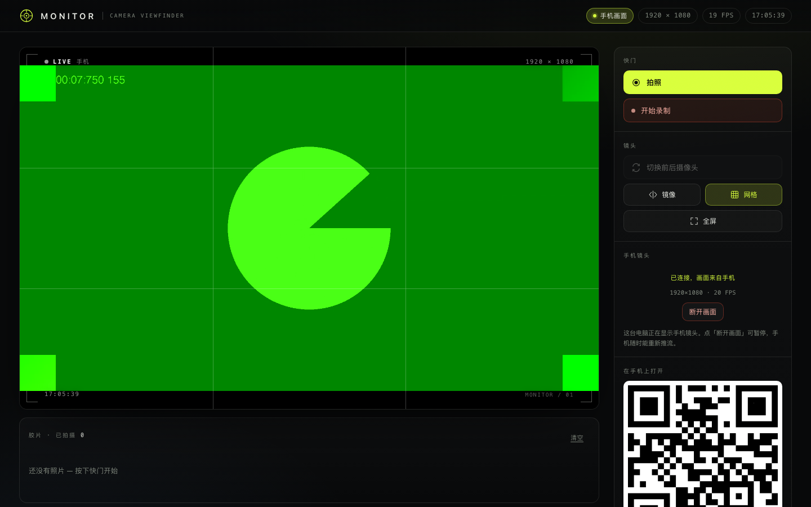
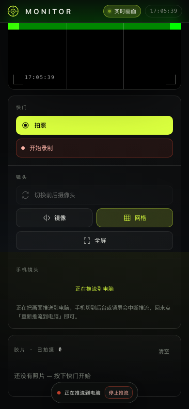

# MONITOR · Rust 原生桌面取景器

把手机屏幕 / 电脑摄像头变成桌面上的实时取景器：**Android（adb + scrcpy 协议）、iPhone / iPad（USB）、本机摄像头**自由切换；屏幕比例预设 + 自定义（fit / fill / stretch）；拍照、录像、胶片条、网格、镜像一应俱全。全部本地完成，画面不上传任何服务器。

> 该目录同时保留了旧的网页版（`web/`），见文末「网页版（旧）」。

## 快速开始

```bash
# 依赖：Rust 工具链 + ffmpeg（Android 另需 adb）
brew install ffmpeg          # 取景 / 录像必需
# adb：安装 Android platform-tools，或 brew install --cask android-platform-tools

cargo build --release
./target/release/monitor-desktop
```

macOS 也可以直接双击 **`启动.command`**（首次自动构建）。

若机器上没有 Rust：`brew install rust`，或 `curl --proto '=https' --tlsv1.2 -sSf https://sh.rustup.rs | sh`。本仓库也支持把工具链装进项目内 `.rust/` 目录（`RUSTUP_HOME`/`CARGO_HOME` 指向它即可），启动脚本会自动识别。

## 设备源

| 源 | 接入方式 | 说明 |
| --- | --- | --- |
| 本机摄像头 | ffmpeg avfoundation | 设备列表即 macOS 采集设备列表 |
| iPhone / iPad | USB + ffmpeg avfoundation | 数据线连接、解锁并「信任此电脑」后，iPhone 会作为视频采集设备出现在列表里 |
| Android | adb + 内嵌 scrcpy-server v3.1 | 开启 USB 调试并授权；应用自动推送内嵌 server（assets/scrcpy-server-v3.1，Apache-2.0）、建立 forward、按 scrcpy 视频协议取 H.264 流并用 ffmpeg 解码 |

左侧设备面板每 10 秒自动刷新，也可点「刷新」。选中即切换画面；切换时旧源自动停止并清理（adb forward / 设备端 server）。

找不到工具时状态栏会给出提示；也可以用环境变量指定路径：`MONITOR_FFMPEG`、`MONITOR_ADB`。

## 屏幕比例

- 预设：跟随源 / 16:9 / 9:16 / 4:3 / 3:4 / 3:2 / 2:3 / 21:9 / 1:1；
- 自定义：任意正数宽高比；
- 三种填充模式：
  - **适应（fit）**：完整画面，比例框内留黑边；
  - **裁切（fill）**：画面居中裁切填满比例框；
  - **拉伸（stretch）**：拉伸变形填满比例框。

## 功能与快捷键

| 功能 | 说明 |
| --- | --- |
| 实时取景 | 叠加时间码 / 分辨率 / FPS；Android 旋转屏幕时画面尺寸自动跟随 |
| 拍照（空格） | 当前帧存为 JPEG（跟随镜像开关），快门闪光反馈 |
| 录像（R） | ffmpeg 编码 H.264 MP4，实时显示时长；源分辨率变化自动缩放到录制尺寸 |
| 胶片条 | 底部缩略图：点击放大查看、打开、在 Finder 中显示、删除 |
| 网格（G） | 三分构图网格 |
| 镜像（M） | 预览与拍照同步镜像 |
| 全屏（F） | 全屏取景 |

照片 / 视频保存在运行目录的 `captures/`（可用 `MONITOR_CAPTURE_DIR` 覆盖）。

## 开发

```bash
cargo test             # 单元测试：比例布局 / 设备解析 / JPEG 流切分 / scrcpy 头 / TTC 字体提取 / 镜像与缩略图
cargo build --release
```

代码结构：

```
src/main.rs      入口（eframe 窗口）
src/app.rs       UI：设备面板 / 比例 / 取景叠加 / 胶片条 / 查看器
src/source.rs    视频源管道：avfoundation 与 scrcpy → ffmpeg → MJPEG → RGB 帧
src/capture.rs   拍照 / 录像（rawvideo → libx264）/ 缩略图
src/ratio.rs     比例布局（fit/fill/stretch + 预设）
src/devices.rs   AVFoundation 设备枚举解析
src/android.rs   adb 设备枚举、内嵌 scrcpy-server
src/ffmpeg.rs    ffmpeg 定位 / 超时执行 / JPEG 流切分
src/font.rs      macOS 系统中文字体（TTC 提取）
assets/          scrcpy-server-v3.1（Apache-2.0, (c) Genymobile）
```

## 网页版（旧）

原来的网页取景器保留在 [`web/`](web/)：`cd web && python3 serve.py`（或双击 `web/启动.command`），支持本机摄像头与「手机当摄像头」（WebRTC 推流）。详见 [`web/README.md`](web/README.md)。

旧版截图：

| 电脑端 · 手机推流中 | 手机端 · 推流中 |
| --- | --- |
|  |  |
