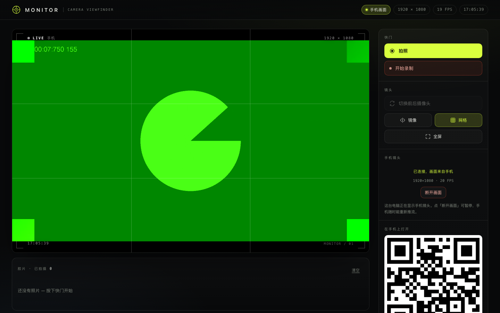
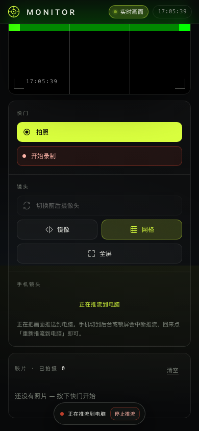
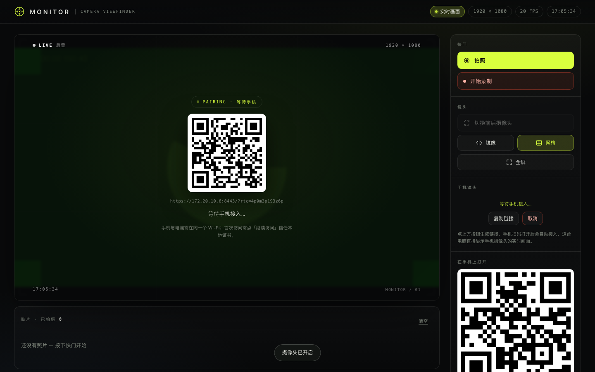
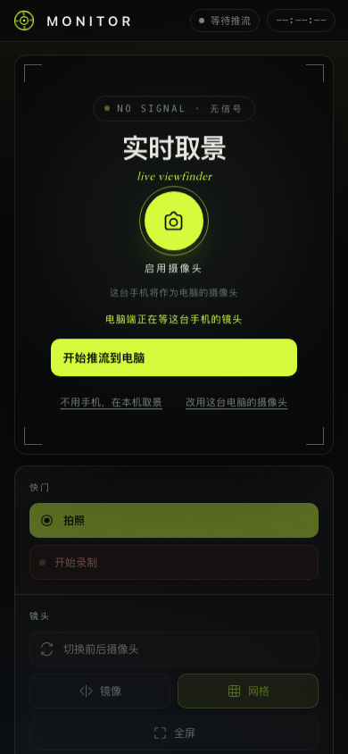

# MONITOR · 摄像头实时取景（网页版）

一个可以直接在网页里显示**手机 / 电脑摄像头实时画面**的本地小站：拍照、录像、下载、扫码手机访问，全部在本地完成，画面不上传任何服务器。

> 桌面版（Rust 原生，支持 Android adb / iPhone USB 屏幕镜像）见项目根目录 README。

两种用法：

1. **本机取景** —— 电脑或手机打开页面，点「启用摄像头」，显示这台设备自己的镜头。
2. **手机当摄像头** —— 电脑打开页面点「用手机当摄像头」，手机扫码后点「开始推流到电脑」，电脑上显示的就是手机镜头（WebRTC 点对点，画面不经过服务器）。



## 快速开始

```bash
cd web
python3 serve.py
```

终端会打印两个地址：

- 电脑本机：<http://localhost:8080> 或 <https://localhost:8443>
- 手机（同一 Wi-Fi）：`https://<当前局域网IP>:8443/`

**地址不用手填**：服务启动时会自动探测当前网卡的局域网 IP，页面右侧的二维码和「访问地址」都是运行时从 `/api/info` 取的。换 Wi-Fi、DHCP 重新分配 IP、换端口之后：

- 页面每 10 秒（以及切回前台时）自动刷新一次二维码地址；
- 服务端每 15 秒检查网络，一旦 IP 变化就自动重新签发含新 IP 的证书并热替换，无需重启；
- 证书 SAN 里没有当前地址时，二维码下方会直接给出提示。

> 用 `localhost` 打开页面也**不会**把 `localhost` 写进二维码：服务端会额外返回一个 `lanShareUrl`（永远是局域网 IP），二维码和「复制链接」都用它，所以手机扫到的一定是能连通的地址。

手机扫码即可打开（页面右下角会显示二维码）。首次打开会提示「证书不受信任」，点 **继续访问 / 高级 → 继续** 即可；也可以访问 `/api/cert` 下载证书后安装信任。

> macOS 用户也可以直接双击 `启动.command`。

## 用手机当摄像头（推荐）

电脑的浏览器**无法直接打开手机的摄像头** —— 没有任何网页 API 能做到这一点。所以走的是标准的 WebRTC 点对点方案：手机采集 → 直连推给电脑，服务器只转发几百字节的连接协商信息。

1. 电脑打开页面（`localhost` 或局域网 IP 都行），右侧「手机镜头」→ 点 **用手机当摄像头**，画面中央出现配对二维码 —— 二维码里的地址自动取当前局域网 IP，不会是 `localhost`；
2. 手机扫码（或复制链接发到手机）打开页面，点 **开始推流到电脑**；
3. 一两秒后电脑上出现手机画面，顶栏状态变成「手机画面」，分辨率 / FPS / 拍照 / 录像都跟着切到手机镜头；
4. 想暂停：电脑端点 **断开画面**（房间保留，手机随时能重新推流），或手机端点底部 **停止推流**。

几点说明：

- 手机和电脑要在**同一个 Wi-Fi**，且路由器没有开启「AP 隔离」；
- 推流时手机屏幕会保持常亮，切到后台或锁屏会中断，回来点「重新推流到电脑」即可；
- 连接走 STUN（`stun.l.google.com:19302`）打洞，绝大多数局域网内可直连；如果公司网络限制 P2P，两端可能连不上；
- 电脑端在等待 / 断开时会显示当前房间的二维码，刷新页面房间会变，需要重新扫码；
- 换 Wi-Fi 导致 IP 变了也不用重启：二维码会自动换成新地址（证书同时重签，十几秒内生效）；
- 连上后右侧会显示一行实时画质（如 `1920×1080 · 30 FPS`），低于 1280 宽或编码被限速时会标红并写明原因（网络带宽不足 / 手机编码性能不足），方便判断糊在哪一环。

### 画面模糊怎么调

推流默认按「保清晰度」策略：采集请求 1920×1080 / 30fps，发送端 `contentHint = 'detail'`、`degradationPreference = 'maintain-resolution'`、码率上限 12 Mbps —— 带宽不够时宁可掉帧也不砍分辨率。如果画面仍然糊：

1. 看右侧画质那行：显示 640×480 之类，说明手机端采集就被降级了（光线太暗、相机被别的 App 占用，或省电模式限制）；
2. 显示「网络带宽不足」：手机和电脑离路由器近一点，尽量用 5 GHz，别让同一网络在跑大文件 / 视频；
3. 手机端推流时切到后台、锁屏会掉到很低的分辨率，回到页面重新推流即可；
4. 显示层不再裁切放大（`object-fit: contain`），所以看到的比例就是手机真实的画面比例。

## 为什么必须 HTTPS

浏览器出于安全考虑，只允许**安全来源**（HTTPS 或 localhost）调用摄像头。`file://` 直接打开页面、或手机通过 `http://192.168.x.x` 访问，都会被拒绝。`serve.py` 会自动生成本地自签名证书并启动 HTTPS。

## 功能

| 功能 | 说明 |
| --- | --- |
| 实时取景 | 支持 1080p、自动适配横竖屏，画面上叠加时间码 / 分辨率 / FPS |
| 拍照 | 快门（或空格键）保存当前帧为 JPEG，可镜像输出 |
| 录像 | 录制摄像头画面（优先 MP4/H.264，否则 WebM），实时显示时长 |
| 胶片条 | 底部缩略图，点击放大、下载或删除 |
| 前后切换 | 手机双摄可切换；自动识别前置并镜像 |
| 补光灯 | 支持 torch 的设备（多数安卓）可开关 |
| 网格 / 全屏 | 三分构图网格、全屏取景（移动端锁定竖屏） |
| 屏幕常亮 | 取景时自动申请 Wake Lock，手机当监视器用不会自动锁屏 |
| 扫码访问 | 电脑页面显示局域网地址二维码，手机扫码直接打开；地址运行时自动检测，用 localhost 打开也不会把 localhost 编进二维码 |
| 手机当摄像头 | 电脑页面生成配对二维码 → 手机扫码授权 → 手机画面实时出现在电脑上，可拍照、录像；点「断开画面」可暂停，手机一键重新推流 |
| 画质诊断 | 推流时显示实际到达电脑的分辨率 / 帧率，画质被降级时标红并给出原因（带宽 / 编码性能） |

## 参数

```bash
python3 serve.py --port 9000        # 换 HTTPS 端口
python3 serve.py --no-tls           # 只用 HTTP（仅 localhost 可用摄像头）
python3 serve.py --auth me:1234     # 局域网访问需要账号密码
python3 serve.py --open             # 启动后自动打开浏览器
```

## 目录

```
index.html            页面结构
assets/css/style.css  样式
assets/js/app.js      摄像头 / 拍照 / 录像逻辑
vendor/qrcode.js      二维码生成（本地文件，无外链）
serve.py              本地 HTTPS 服务器 + WebRTC 信令（只转发 SDP/ICE，不碰音视频）
.certs/               自动生成的本地证书（首次运行创建）
```

## 截图

| 电脑端 · 手机推流中 | 手机端 · 推流中 |
| --- | --- |
|  |  |

| 配对二维码 | 手机扫码后 |
| --- | --- |
|  |  |

## 部署到公网

把整个目录上传到任意**支持 HTTPS** 的静态托管（GitHub Pages、Vercel、Netlify、Cloudflare Pages 等）即可，无需后端：页面检测到没有 `/api/info` 时会自动用当前域名生成二维码。摄像头权限由浏览器在客户端授予，画面不会离开设备。
